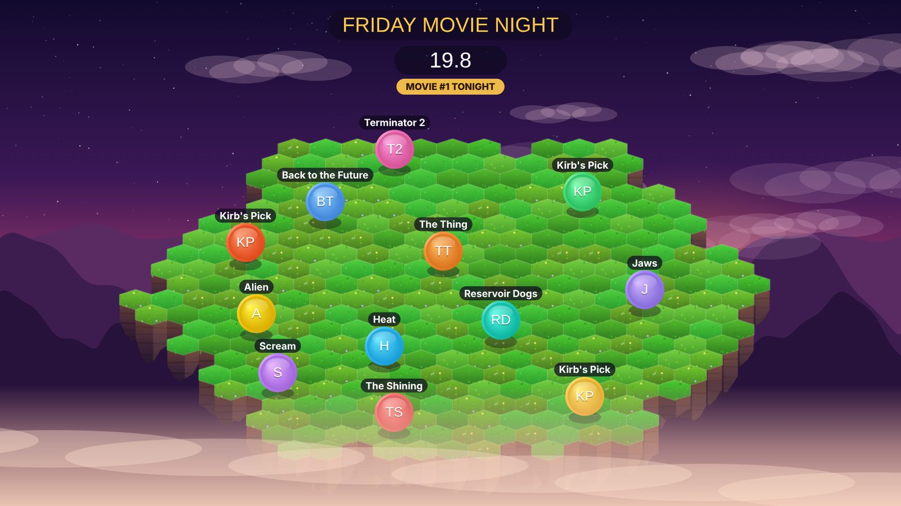
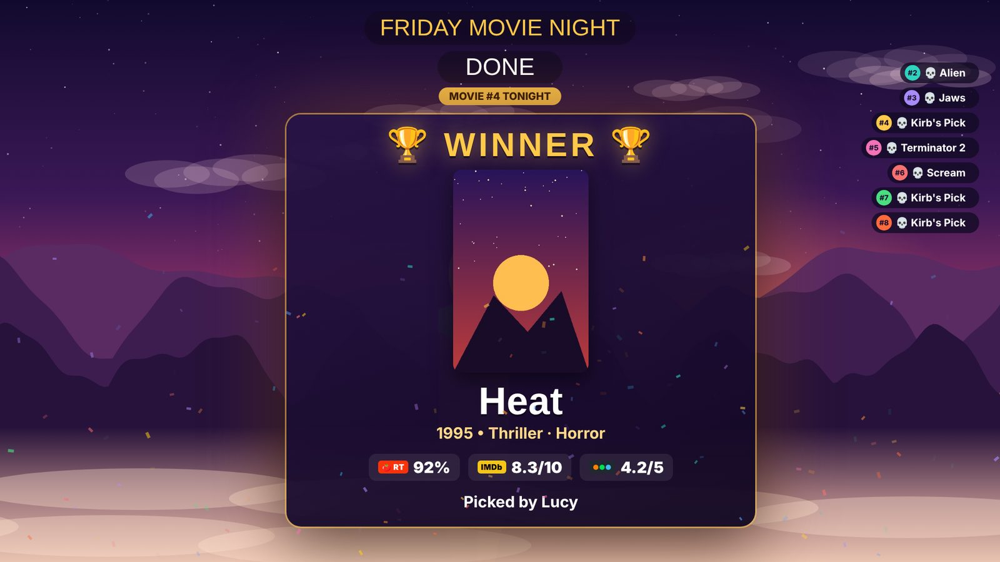
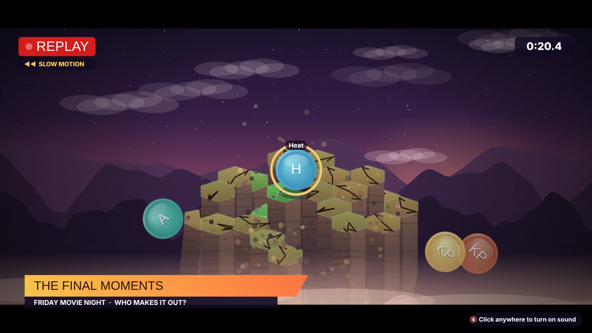
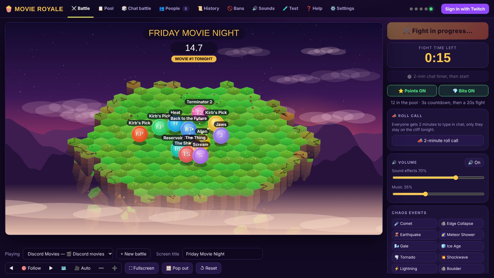
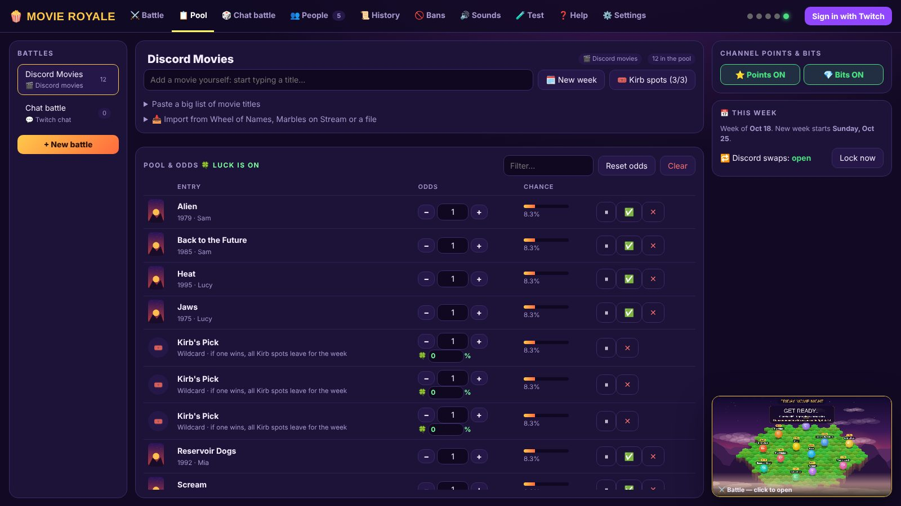

# 🍿 Movie Royal

**A battle-royal "wheel" for Twitch streamers.** Everything on your list becomes a piece on a floating cliff that crumbles from the edges. Pieces bump, dash and fly off. The last one standing wins.

Made for picking movies with chat: viewers suggest movies in **Discord**, anything you've already watched on **Letterboxd** is blocked, and **channel points & bits** let chat unleash chaos on everyone. It works for anything else too: games, snacks, challenges and giveaways.



| Winner screen | Instant replay |
|---|---|
|  |  |

| Control panel | Pool & odds |
|---|---|
|  |  |

## ⬇️ Download

1. Go to **[Releases](../../releases/latest)** and download **`MovieRoyal-Setup-x.y.z.exe`** (Windows 10/11).
2. Run it. Windows may say **"Windows protected your PC"** because the app isn't code-signed. Click **More info → Run anyway**.
3. Movie Royal opens a **step-by-step setup guide**. Every step has a test button, and every step is optional.

It's free. Everything runs on your own PC: there are no accounts on our side and nothing to host. Updates show up inside the app ("Update available — install?").

## ✨ What it does

**The battle**
- A crumbling cliff, physics bumps, and a fight of 30 seconds (or however long you choose). The winner is drawn by **exact odds**, like a real wheel, and the fight plays it out.
- **Bigger odds = bigger piece.** Change anyone's odds with + / −.
- A **camera** that follows the action. You can scroll to zoom, drag to move, or click a piece to follow it.
- A **slow-motion instant replay** of the final seconds, sports-broadcast style.
- **Winner card** with poster, year, genre, **Rotten Tomatoes / IMDb / Letterboxd** ratings and who picked it.
- Up to **1000 pieces** on the cliff, which grows with the number of entries.
- **16 maps**: space with low gravity, a lava lake that rises and swallows the cliff, Rainbow Road, the Hollywood sign crumbling in an earthquake, a neon city with lasers to jump, a Smash-style stage where KO'd pieces can fly back in, a desert with a giant sand worm, a castle with dragons, a bomb arena, a wrestling ring, Pong and more. You can pick one, go random, or let **chat vote** on it.
- **Every power is a button** under the battle screen, and **🔀 Shuffle** scatters the pieces before the fight.

**Discord movie picks**
- `/suggest` searches movies as you type and shows `Title (Year)`.
- Blocked movies still show up, with the reason: already watched on Letterboxd, banned, this year's release, another movie from the same series already in, or already picked by someone.
- Pick rules are handled for you:
  - 3 picks each, and no new ones until all of them are watched.
  - One person per movie.
  - Win a movie and your other picks sit out until Sunday.
  - Wildcard "Kirb" spots refill each week.
- `/swap` trades one of your movies for another (it locks when you go live). `/mymovies` and `!mymovies name` show what's left.
- The bot makes its own **#movies-royal** channel and pins a message listing every command.
- **☁️ 24/7 mode:** a free Cloudflare copy of the bot keeps taking picks while your PC is off, and the app pulls them in when you open it.

**Twitch**
- **Channel points & bits** trigger chaos that hits everyone equally: comets, earthquakes, tornadoes, meteor showers, ice, low gravity… Edit reward prices right in the app, or turn points and bits off with one click.
- Only people **chatting this stream** get their movies on the cliff.
- **Claim timer**: if the winner types in chat, they win. The winner is also posted in chat.
- **Chat battles**: viewers type `!join`, which is perfect for giveaways.
- **Ball colors**: viewers type `!color pink` to recolor their piece. It's silent, so there's no chat spam.

**And**
- Custom battles: movies, text, pictures or Twitch chat. Paste big lists (commas or new lines, `x3` for triple odds).
- **Import** from Wheel of Names, Marbles on Stream, CSV, JSON or text files.
- Optional **luck**: every battle a movie loses makes it a little more likely to win next time.
- History with search and a **"who won what"** list, a bans list, custom sounds, a test tab, a searchable help tab, and backup/restore.

## 🧭 Setting it up

The app has a setup guide built in. You'll need:

| What | Why | Cost |
|---|---|---|
| Twitch sign-in | channel points, bits, chat | free |
| [TMDB](https://www.themoviedb.org/settings/api) token | movie search, posters | free |
| [OMDb](https://www.omdbapi.com/apikey.aspx) key | Rotten Tomatoes + IMDb ratings | free (optional) |
| Letterboxd username | block movies you've seen | free (optional) |
| A Discord bot | `/suggest` in your server | free (optional) |

Full instructions are in **[docs/GUIDE.md](docs/GUIDE.md)** and in the app's **❓ Help** tab.

> **Note:** Twitch features need Movie Royal running (it can sit in the tray and start with Windows). For Discord, turn on **☁️ 24/7 mode**: a free Cloudflare copy of the bot answers `/suggest` even when your PC is off.

## ❓ FAQ

**Do I need a Twitch bot account?** No. Replies and winner posts come from your own account.

**Where's my data?** `%APPDATA%\Movie Royal\data`. Updates and uninstalls don't touch it. Use **Settings → Download backup** to keep a copy.

**Mac / Linux?** The installer is Windows-only. You can run it from source on any OS (see below) and use it in your browser.

**Found a bug or have an idea?** [Open an issue](../../issues/new/choose).

## 🛠️ Running from source

Needs [Node.js](https://nodejs.org) 20+.

```bash
npm install
npm start            # browser version at http://localhost:3737
npm run desktop      # desktop window
npm run build:win    # builds dist/MovieRoyal-Setup-<version>.exe (works on Windows, macOS or Linux)
```

The code is laid out like this:
- **`src/`**: the local server. `server.js` is the hub; there's a module each for `discord.js`, `twitch.js`, `letterboxd.js`, `tmdb.js`, `ratings.js` (OMDb/Letterboxd), `movies.js` (pick rules) and `importer.js`.
- **`public/`**: the control panel (`control.html`), the game screen (`game.html`), `setup.html`, `help.html` and `sfx.js` (synthesized sounds).
- **`desktop/`**: the Electron wrapper.

## 📄 License

[MIT](LICENSE) © 2026 Derek Viera. Movie data and posters come from [TMDB](https://www.themoviedb.org) (this product uses the TMDB API but is not endorsed or certified by TMDB). Ratings come from [OMDb](https://www.omdbapi.com) and [Letterboxd](https://letterboxd.com). The app isn't affiliated with Twitch, Discord, Letterboxd, Wheel of Names or Marbles on Stream.
